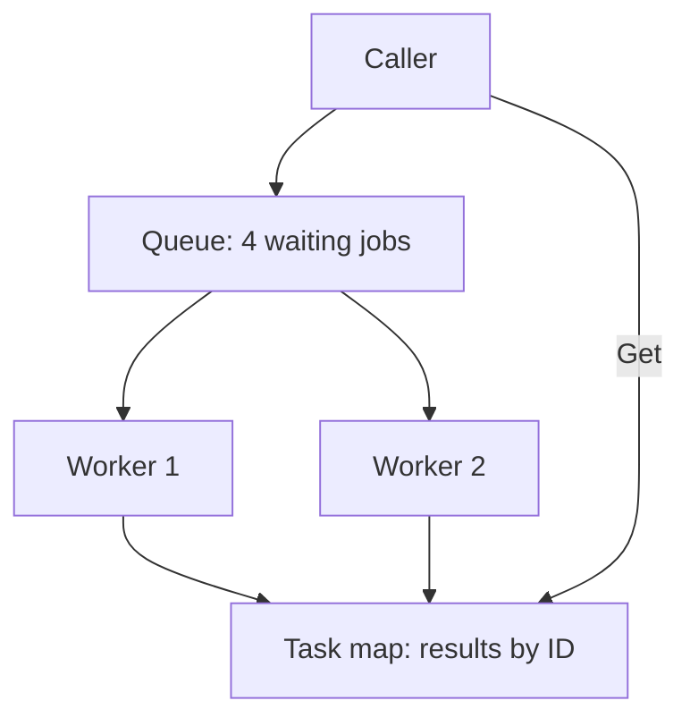

# SIS Text Analyzer

SIS Checkpoint 2 extends the Checkpoint 1 text analyzer with concurrent processing. Each command-line argument creates one task. The analyzer counts whitespace-separated words with `strings.Fields` and Unicode code points with `utf8.RuneCountInString`. Punctuation stays in its word. Spaces and newlines count as characters. Whitespace-only input is an error.

## Run

Use Go 1.27 or later. All dependencies belong to the standard library. Run these commands from the directory containing `go.mod`.

```bash
go run .
go run . "Hello Go" "Привет мир"
```

The first command runs two sample tasks. The second prints:

```text
Task 1: completed | words=2 | characters=8
Task 2: completed | words=2 | characters=10
```

The CLI uses `SubmitWait` to submit each valid task and waits for the workers before printing results in input order. Workers can finish in either order. Invalid input produces a diagnostic and a nonzero exit code. On this error path, shutdown still drains work accepted earlier.

## Tasks and workers

1. `NewTaskService(TextAnalyzer{})` starts **2 reusable workers** reading a shared buffered channel with **4 waiting slots**. Workers retain their slots in the pool between tasks.
2. `Create(text)` validates the text, assigns a unique ID and stores a pending task in memory. `Submit(id)` queues an existing task and returns as soon as the pool accepts it. Call `Get(id)` to inspect a snapshot while workers run. The original synchronous `Process(id)` submits to the same pool and waits for that attempt.
3. A full queue makes `Submit` return `ErrQueueFull` immediately. A new task stays pending and can be submitted again. The CLI uses `SubmitWait` to wait for space when processing a batch. A condition variable releases the service lock while the caller waits. A worker taking a job wakes waiting callers, which check the service and task state again before sending.
4. `Shutdown()` stops admission, closes the queue and wakes blocked submitters with `ErrStopped`. Workers drain all accepted jobs, including buffered ones, and exit. Every shutdown caller waits for the same worker group. Stored results remain readable until the process exits.

| Event | Transition or outcome |
| --- | --- |
| Create and submit | `pending → queued` |
| A worker takes the job | `queued → processing` |
| Analysis succeeds | `processing → completed`; store this task's result |
| Analysis returns an error | `processing → failed`; keep the error in `LastError` for inspection. An accepted retry moves it to queued and clears the error. A rejected retry keeps the error. |
| Submit a queued, processing or completed task | `ErrInvalidTaskState` |
| Submit an unknown ID while running, or retrieve an unknown ID | `ErrTaskNotFound` |
| Submit after shutdown starts | `ErrStopped` |



## Why concurrent access is safe

The service's `sync.RWMutex` protects the ID counter, task map and shutdown flag. A submitter holds its write lock while checking the status, sending to the queue and recording the queued state. Two callers cannot both claim the same pending task. Shutdown closes the channel under this same lock, so it cannot close during a send.

A worker records the processing state under the lock, releases it while analyzing the text, and takes it again to publish the result and final state together. This lets other workers analyze independent texts and callers read tasks at the same time. `Get` takes a read lock and copies the result so a caller cannot mutate the stored value. Shutdown releases the lock before waiting on the `sync.WaitGroup`, letting workers finish their writes.

## Files and verification

`main.go` contains the CLI, `analyzer.go` the text rules, `task.go` the data model and `service.go` the queue, workers and in-memory store. The original analyzer and service tests cover Checkpoint 1 behavior. `pool_test.go` exercises overlap, queue pressure, duplicate submissions, concurrent readers and writers, retries and shutdown.

```bash
gofmt -l .
go vet ./...
go test ./...
go test -race ./...
```

The formatting check should print nothing. To watch the capacity and shutdown test specifically, run:

```bash
go test -v -run TestPoolCapacityAndShutdown
```

The test holds two workers inside the processor using a channel. With both tasks still processing, it fills all four waiting slots and verifies that Submit returns ErrQueueFull and SubmitWait blocks. It then checks both ways the wait can end: a worker frees a slot, or shutdown rejects the waiting submission and drains the six accepted tasks. The test coordinates goroutines with channels and `testing/synctest`.
